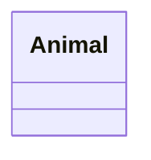
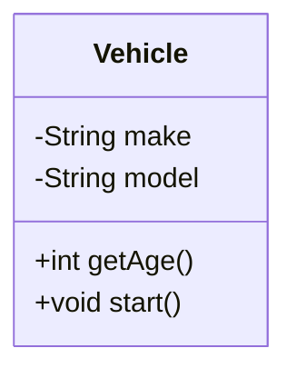
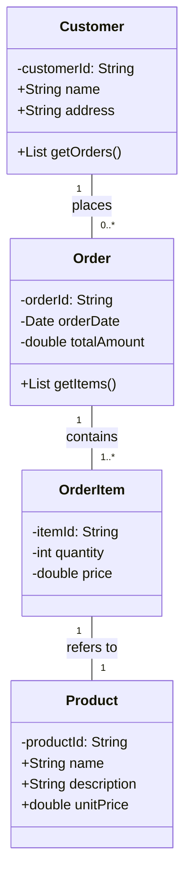

# Mermaid Class Diagram Syntax

Class diagrams in Mermaid describe the structure of a system by showing the system's classes, their attributes, methods, and the relationships between classes.

## Diagram Declaration

Starts with the `classDiagram` keyword.



## Classes

### Defining a Class

You can define classes and their members (fields/attributes and methods/functions).

-   **Simple class**: `class ClassName`
-   **Class with members**:
    ```mermaid
    classDiagram
        class Animal {
            +String name
            +int age
            +void speak()
        }
    ```

### Members (Fields and Methods)

-   **Visibility**:
    -   `+`: public
    -   `-`: private
    -   `#`: protected
    -   `~`: package/internal
-   **Static**: Add `$` before the member name (`+ $staticField`).
-   **Abstract**: Add `*` before the member name (`+ *abstractMethod()`).
-   **Data Type**: Specify after the member name (`+ String name`).
-   **Return Type**: Specify after method parentheses (`+ void speak()`).

Example:


## Relationships

Relationships define how classes interact.

-   **Generalization (Inheritance)**: `ClassA <|-- ClassB` (ClassB inherits from ClassA)
-   **Composition**: `ClassA *-- ClassB` (ClassB is part of ClassA, strong ownership)
-   **Aggregation**: `ClassA o-- ClassB` (ClassB is part of ClassA, weak ownership)
-   **Association**: `ClassA -- ClassB` (General relationship)
-   **Dependency**: `ClassA <.. ClassB` (ClassA uses ClassB)
-   **Realization (Interface Implementation)**: `ClassA <|.. ClassB` (ClassB implements ClassA interface)

You can add labels and cardinalities to relationships:
`ClassA "1" -- "many" ClassB : has`

Example:
```mermaid
classDiagram
    Animal <|-- Dog
    Animal <|-- Cat
    Car "1" *-- "4" Wheel : has
    Person o-- House : owns
    Customer -- Order
    Report <.. DataGenerator : uses
    <<interface>> Shape
    Rectangle <|.. Shape
```

## Example Class Diagram


