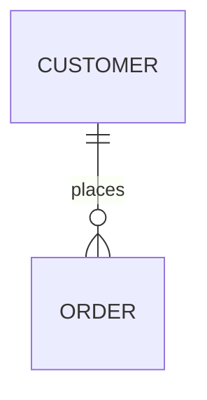
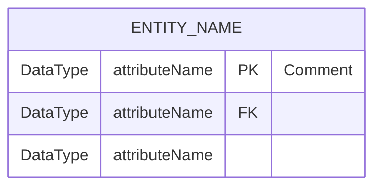
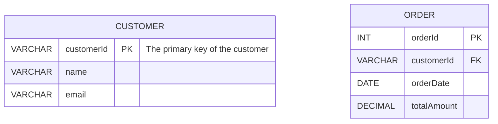
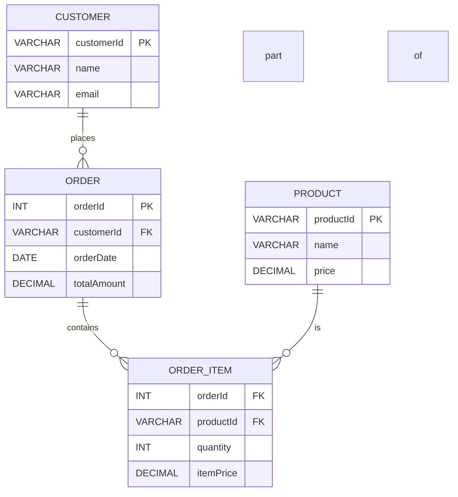

# Mermaid Entity-Relationship Diagram Syntax

ER Diagrams in Mermaid are used to model the logical structure of a database, showing entities, their attributes, and relationships between entities.

## Diagram Declaration

Starts with the `erDiagram` keyword.

## Entities and Attributes

Entities are defined by their name, followed by their attributes.

-   **`DataType`**: The type of the attribute (e.g., `VARCHAR`, `INT`, `DATE`).
-   **`attributeName`**: The name of the attribute.
-   **`PK`**: (Optional) Denotes a Primary Key.
-   **`FK`**: (Optional) Denotes a Foreign Key.
-   **`"Comment"`**: (Optional) A descriptive comment for the attribute.

Example:

## Relationships

Relationships define how entities are connected. They are defined using a specific syntax:

`Entity1 --|{ Entity2 : RelationshipLabel`

### Components of a Relationship:

1.  **`Entity1`**: The name of the first entity.
2.  **`Cardinality of Entity1`**:
    -   `|o`: Zero or one
    -   `||`: Exactly one
    -   `}o`: Zero or many
    -   `}|`: One or many
3.  **`Connector`**:
    -   `--`: Association
    -   `..`: Identifying (weak entity)
4.  **`Cardinality of Entity2`**: Same as Entity1's cardinality, but for Entity2.
5.  **`Entity2`**: The name of the second entity.
6.  **`RelationshipLabel`**: A descriptive label for the relationship.

Example:
-   `CUSTOMER ||--o{ ORDER : places`
    -   "A CUSTOMER has exactly one relationship with"
    -   "places"
    -   "ORDER, and an ORDER can have zero or many CUSTOMERs (this is typically read from Entity1 to Entity2, so 'Customer places zero or many Orders')."

### Common Cardinalities:

-   **One-to-One**: `ENTITY1 ||--|| ENTITY2` (e.g., `PERSON ||--|| PASSPORT : has`)
-   **One-to-Many**: `ENTITY1 ||--o{ ENTITY2` (e.g., `DEPARTMENT ||--o{ EMPLOYEE : contains`)
-   **Many-to-One**: `ENTITY1 }o--|| ENTITY2` (e.g., `EMPLOYEE }o--|| DEPARTMENT : belongs to`)
-   **Many-to-Many**: `ENTITY1 }o--o{ ENTITY2` (e.g., `STUDENT }o--o{ COURSE : enrolls in`)

## Example ER Diagram

