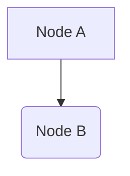
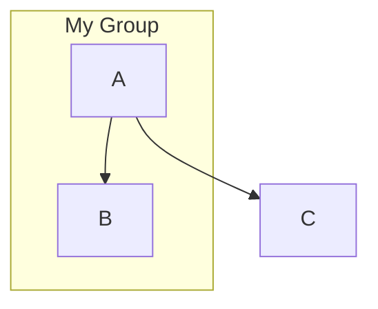
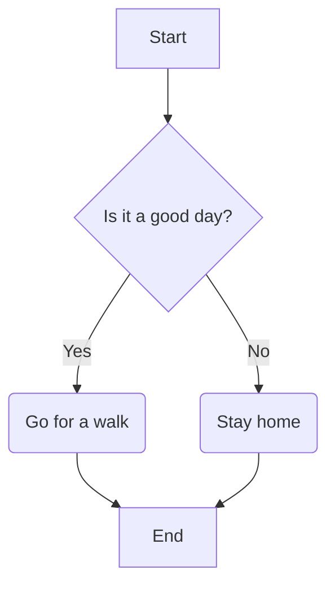

# Mermaid Flowchart Syntax

Flowcharts in Mermaid are defined using the `graph` keyword, followed by the direction of the flow.

## Diagram Direction

The direction specifies how the nodes are laid out.

-   `TD` or `TB`: Top to Down
-   `BT`: Bottom to Top
-   `LR`: Left to Right
-   `RL`: Right to Left

Example:


## Nodes (Shapes)

Nodes can have various shapes depending on the enclosure used.

-   **Square/Rectangle (default)**: `id[Text]`
    ```mermaid
    graph TD
        A[Start]
    ```
-   **Rounded edges**: `id(Text)`
    ```mermaid
    graph TD
        B(Process)
    ```
-   **Stadium**: `id([Text])`
    ```mermaid
    graph TD
        C([End])
    ```
-   **Cylindrical (Database)**: `id[(Text)]`
    ```mermaid
    graph TD
        D[(Data)]
    ```
-   **Circle**: `id((Text))`
    ```mermaid
    graph TD
        E((Input))
    ```
-   **Asymmetric (Subroutine)**: `id>Text]`
    ```mermaid
    graph TD
        F>Subroutine]
    ```
-   **Rhombus (Decision)**: `id{Text}`
    ```mermaid
    graph TD
        G{Decision?}
    ```

## Links (Arrows)

Links connect nodes and can include text.

-   **Basic arrow**: `A --> B`
-   **Arrow with text**: `A -- Text --> B`
-   **Dotted arrow**: `A -.-> B`
-   **Dotted arrow with text**: `A -. Text .-> B`
-   **Thick arrow**: `A ===> B`
-   **Thick arrow with text**: `A === Text ===> B`

## Subgraphs

Group nodes together within a subgraph.



## Example Flowchart


