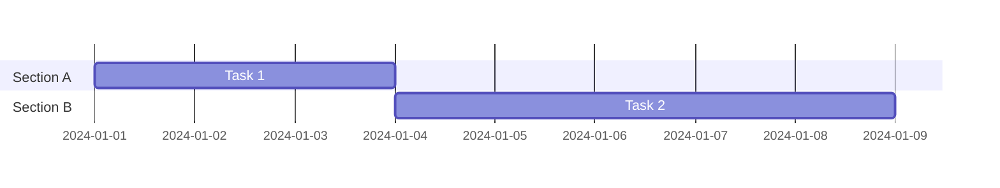
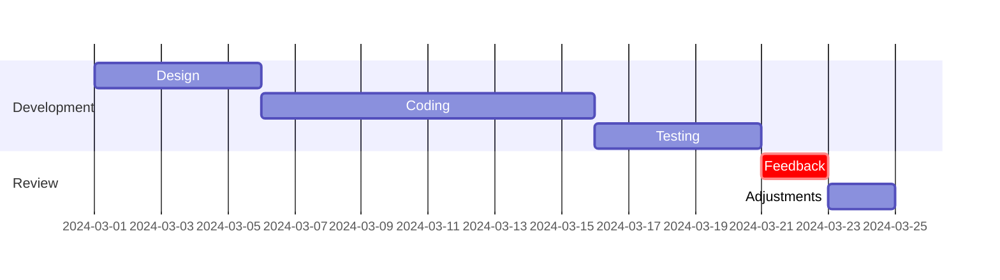
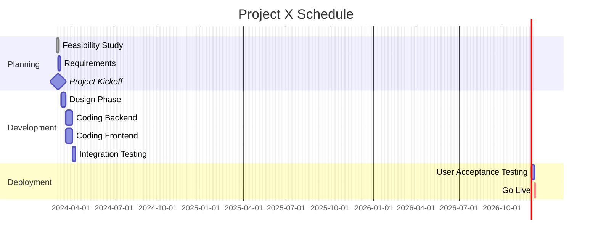

# Mermaid Gantt Chart Syntax

Gantt charts in Mermaid are used to illustrate a project schedule, showing the start and finish dates of the terminal elements and summary elements of a project.

## Diagram Declaration

Starts with the `gantt` keyword.

```mermaid
gantt
    title A Gantt Chart
```

## Title and Date Format

-   **Title**: `title Your Project Title`
-   **Date Format**: `dateFormat YYYY-MM-DD` (defines the format for dates used in tasks)

Example:


## Sections

Tasks can be grouped into sections.



## Tasks

Each task is defined on a new line with the following format:

`Task Name :id, start, duration`
or
`Task Name :status, id, start, duration`
or
`Task Name :status, id, after previous_id, duration`

-   **`Task Name`**: A descriptive name for the task.
-   **`status` (optional)**: Can be `active`, `done`, `crit` (critical), or `milestone`.
    -   `active`: The task is currently in progress.
    -   `done`: The task is completed.
    -   `crit`: The task is critical for project completion.
    -   `milestone`: A significant point in the project.
-   **`id` (optional)**: A unique identifier for the task, used for dependencies.
-   **`start`**: The start date in the format specified by `dateFormat`.
-   **`duration`**: The length of the task (e.g., `3d` for 3 days, `2w` for 2 weeks).
-   **`after previous_id`**: Makes the task start immediately after another task with `previous_id` finishes.

Example Task Definitions:


## Milestones

Milestones are specific points in time.

`Milestone Name :milestone, id, date`

Example:
```mermaid
gantt
    Project Start :milestone, ms1, 2024-03-01
    Final Review  :milestone, ms2, 2024-03-25
```

## Example Gantt Chart


