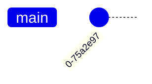

# Mermaid Git Graph Syntax

Git Graphs in Mermaid visualize Git repository history, showing commits, branches, merges, and other Git operations.

## Diagram Declaration

Starts with the `gitGraph` keyword.

## Commands

### Commits

-   `commit`: Adds a new commit to the current branch.
-   `commit id: "Commit ID"`: Adds a commit with a specific ID.
-   `commit tag: "Tag Name"`: Adds a tag to the commit.
-   `commit type: BREAKING | FEAT | FIX`: Specifies the commit type (optional, affects styling).
-   `commit msg: "Commit message"`: Adds a commit message.

### Branches

-   `branch branchName`: Creates a new branch from the current commit.
-   `checkout branchName`: Switches to an existing branch.
-   `merge branchName`: Merges the specified branch into the current branch.
-   `cherry-pick id: "Commit ID"`: Cherry-picks a specific commit.
-   `reverse id: "Commit ID"`: Reverses a specific commit.

## Example Git Graph

