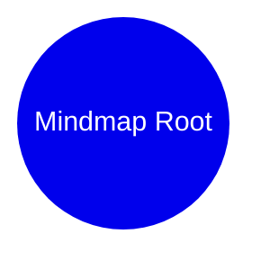
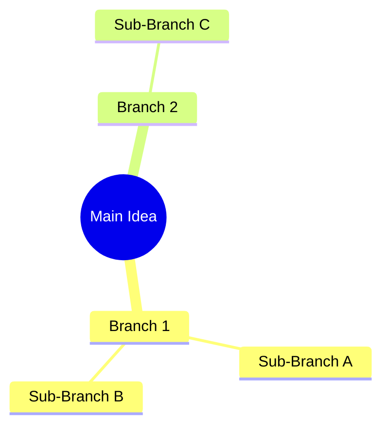
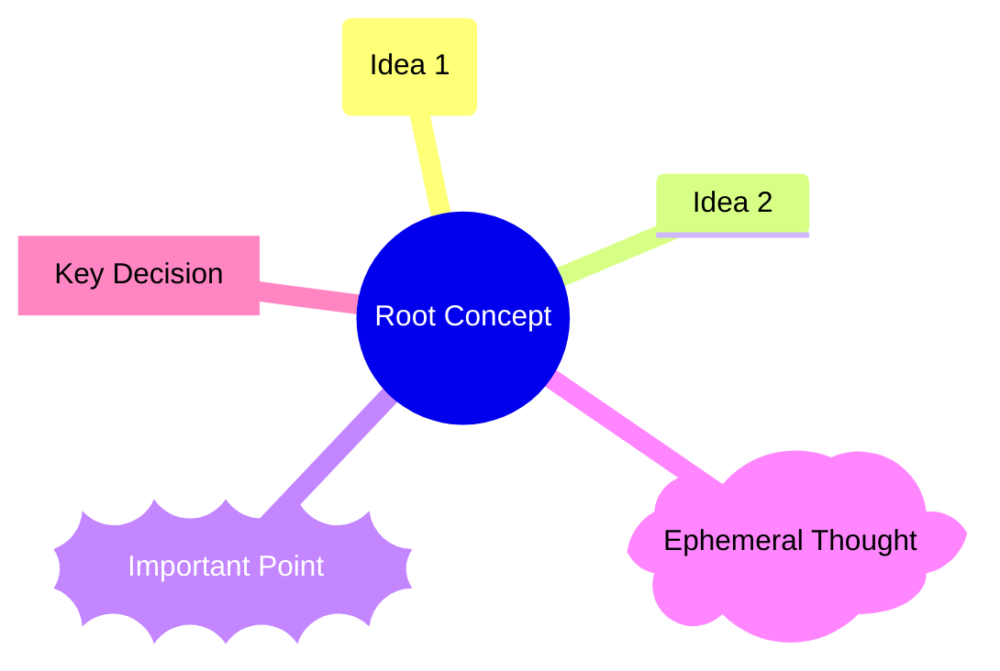
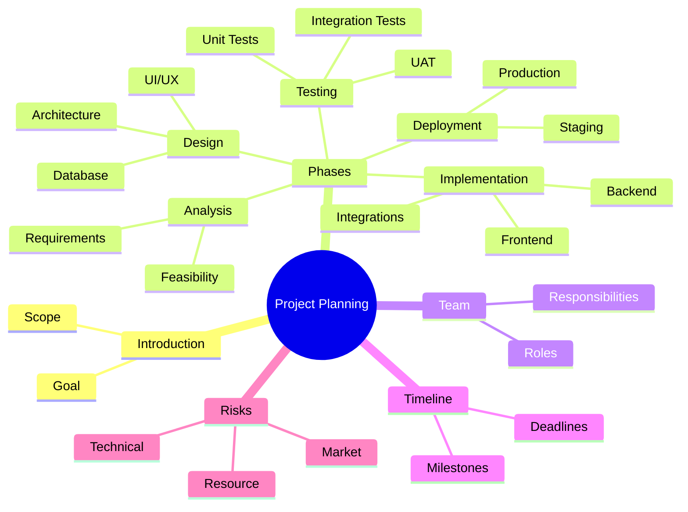

# Mermaid Mindmap Syntax

Mindmaps in Mermaid visualize hierarchical information in a branching structure, useful for brainstorming and organizing ideas.

## Diagram Declaration

Starts with the `mindmap` keyword.

## Nodes

Nodes are defined by indentation. The top-most node is the root.

-   **Root Node**: Must be the first line, often with `((text))` for a rounded shape.
-   **Child Nodes**: Indent to create child nodes. Each level of indentation represents a new level in the hierarchy.

Example:

### Node Shapes

Mermaid mindmaps support various node shapes:

-   **Rounded rectangle (default for children)**: `Node text`
-   **Rounded rectangle**: `(Node text)`
-   **Circle**: `((Node text))`
-   **Bang (Hexagon)**: `))Node text((`
-   **Cloud**: `)Node text(`
-   **Square**: `[Node text]`

Example:

## Example Mindmap

