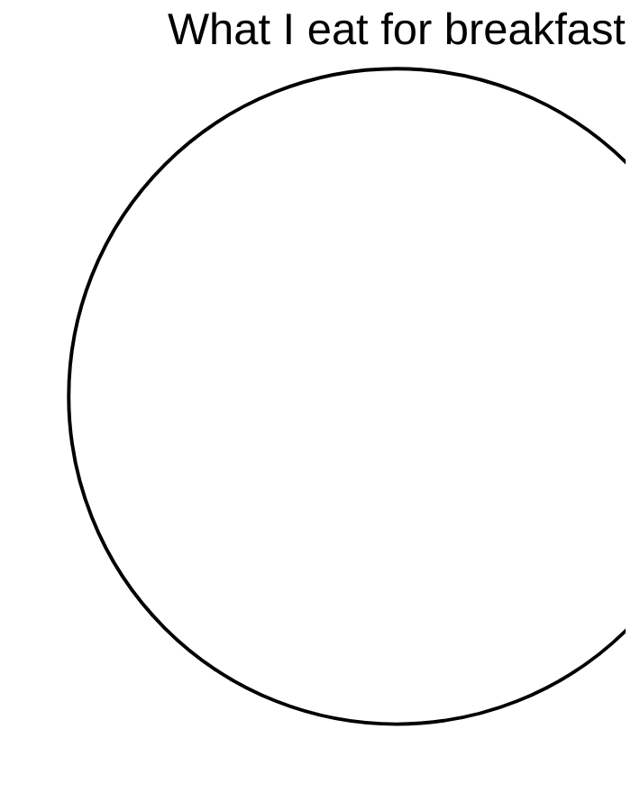
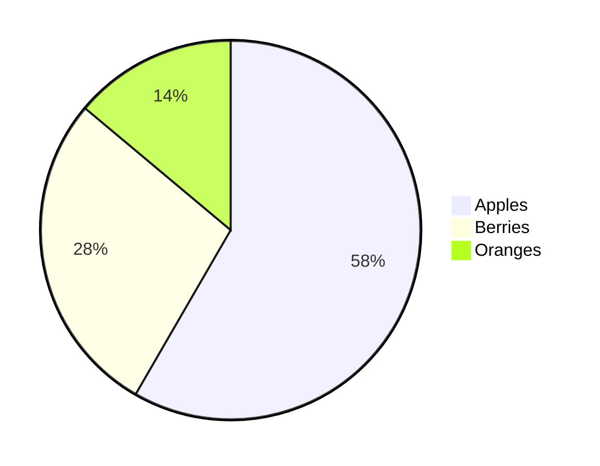
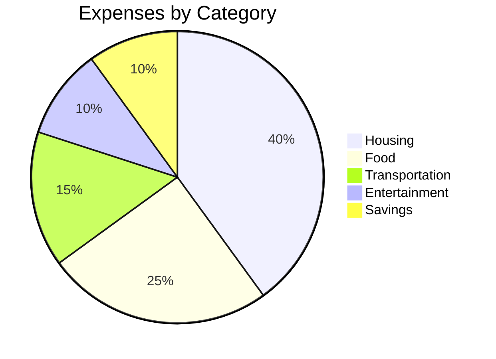

# Mermaid Pie Chart Syntax

Pie Charts in Mermaid visualize the proportional distribution of a whole into different categories.

## Diagram Declaration

Starts with the `pie` keyword.

## Sections and Values

Each section represents a category, followed by its numerical value.

`"Section Name" : Value`

-   **`Section Name`**: The label for the slice of the pie.
-   **`Value`**: A numerical value representing the size of the slice. Mermaid automatically calculates percentages.

Example:

## Options

-   `showData`: Setting this to `true` will display the actual data values on the pie chart, in addition to percentages. (This is a global config option, not part of the pie chart syntax itself)

## Example Pie Chart

