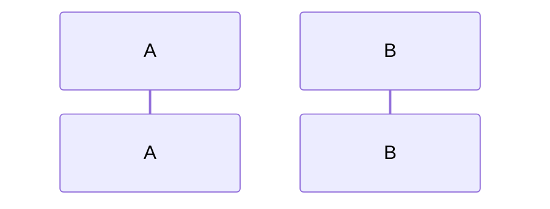
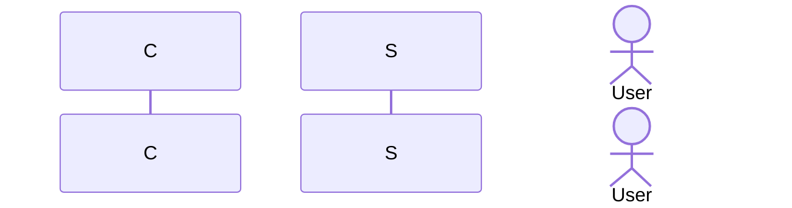
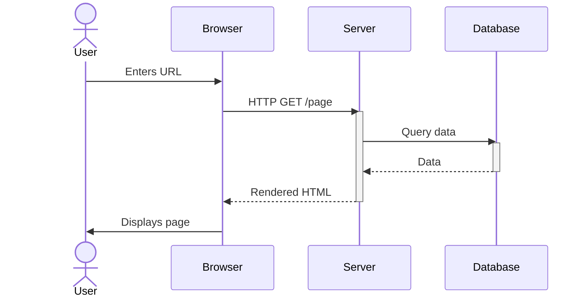

# Mermaid Sequence Diagram Syntax

Sequence diagrams in Mermaid illustrate how processes operate with one another and in what order.

## Diagram Declaration

Starts with the `sequenceDiagram` keyword.



## Participants

Participants are the entities involved in the sequence.

-   **Declare participants**: `participant Name` or `actor Name` (for actors)
-   **Order**: The order of `participant` declarations defines the horizontal order in the diagram.
-   **Aliases**: `participant RealName as Alias`

Example:


## Messages

Messages are the communications between participants.

-   **Solid arrow**: `A->B: Message` (synchronous call)
-   **Dashed arrow**: `A-->B: Message` (asynchronous call / reply)
-   **Open arrow**: `A->>B: Message` (asynchronous call, no return expected)
-   **Dotted line**: `A-->>B: Message` (asynchronous reply)
-   **Activation/Deactivation**:
    -   `activate Participant`
    -   `deactivate Participant`
    -   Shorthand: `A->>B: Call
activate B` and `B-->>A: Response
deactivate B`

## Loops

Represent repeated sections of messages.

```mermaid
loop Every second
    Client->Server: Ping
    Server-->Client: Pong
end
```

## Alt (Alternatives)

Represent conditional logic.

```mermaid
alt successful case
    Client->Server: Request data
    Server-->Client: Data response
else error case
    Client->Server: Request data
    Server--xClient: Error response
end
```

## Opt (Optional)

Represent optional steps.

```mermaid
opt Optional step
    Client->Server: Send notification
end
```

## Critical Section

Highlight a critical section.

```mermaid
critical Critical operation
    Client->Database: Commit transaction
option Rollback
    Client--xDatabase: Rollback
end
```

## Example Sequence Diagram


