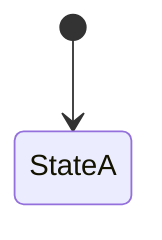
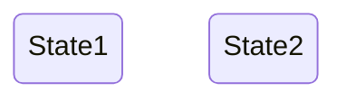
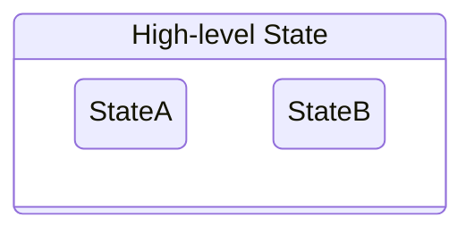
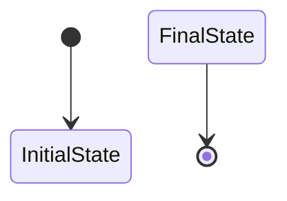
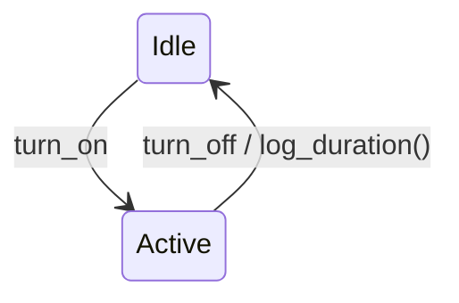
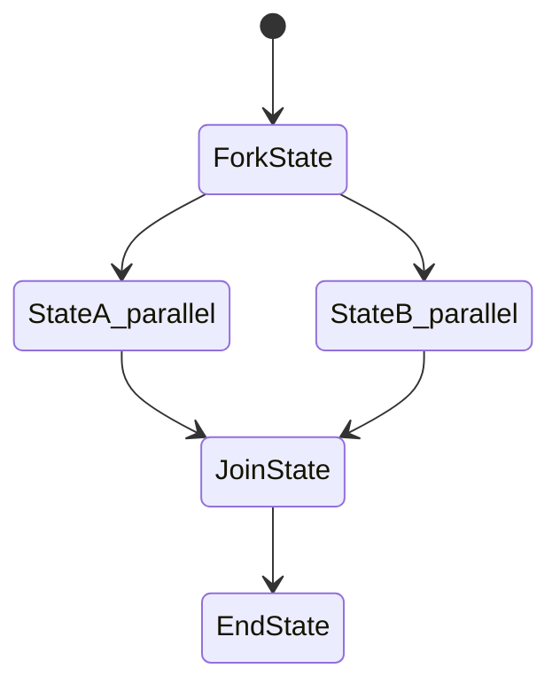
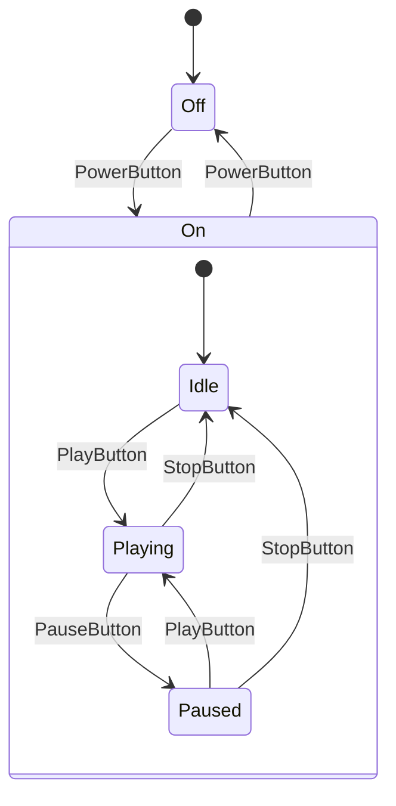

# Mermaid State Diagram Syntax

State diagrams in Mermaid visualize the different states an object can have and the transitions between those states due to events.

## Diagram Declaration

Starts with the `stateDiagram-v2` keyword (for the newer syntax version).

## States

### Simple States

A simple state is defined by its name.

### Composite States (Nested States)

States can contain other states.

### Start and End States

-   **Start State**: `[*]`
-   **End State**: `[*]` (when it's the target of a transition)

Example:

## Transitions

Transitions define how the system moves from one state to another.

`SourceState --> TargetState`

You can add a description of the event that triggers the transition, and optionally an action.

`SourceState --> TargetState: EventDescription / Action`

Example:

## Concurrency (Fork and Join)

Represent parallel activities.

-   **Fork**: `StateA --> fork_state --> StateB` and `fork_state --> StateC`
-   **Join**: `StateB --> join_state --> StateD` and `StateC --> join_state`

Example:

## Example State Diagram

