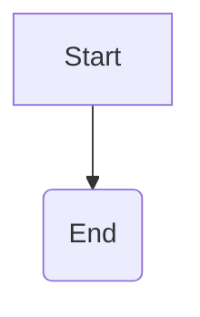

# Mermaid Syntax Overview

Mermaid uses a simple, markdown-like text syntax to define diagrams. Each diagram starts with a declaration of its type, followed by its specific syntax.

## General Structure

A Mermaid diagram typically begins with a keyword declaring the type of diagram, for example:

-   `graph TD`: Declares a flowchart (`graph`) with a Top-Down (`TD`) direction.
-   `A[Start]`: Defines a node with ID `A` and text "Start". Square brackets `[]` typically denote a rectangle node.
-   `-->`: Defines a connection or edge between nodes.
-   `B(End)`: Defines a node with ID `B` and text "End". Parentheses `()` typically denote a rounded-edge node.

## Node Shapes

Mermaid supports various node shapes:

-   **Rounded edges**: `id(text)`
-   **Stadium-shaped**: `id([text])` (Flowcharts only)
-   **Subroutine**: `id[[text]]`
-   **Cylindrical**: `id[(text)]`
-   **Circle**: `id((text))`
-   **Asymmetric**: `id>text]`
-   **Rhombus**: `id{text}`
-   **Hexagon**: `id{{text}}`
-   **Parallelogram**: `id[/text/]` or `id[	ext\]`
-   **Trapezoid**: `id[/text\]` or `id[	ext/] `

## Links/Edges

Connections between nodes can be:

-   **Open arrow**: `A --> B`
-   **Arrow with text**: `A -- text --> B`
-   **Dotted line**: `A ...> B`
-   **Dotted line with text**: `A ... text ...> B`
-   **Thick line**: `A ===> B`
-   **Thick line with text**: `A === text ===> B`

## Styling

Mermaid allows some basic styling using CSS classes or inline styles, though the focus is on content.

Refer to the specific diagram type documentation for more detailed syntax and options.
