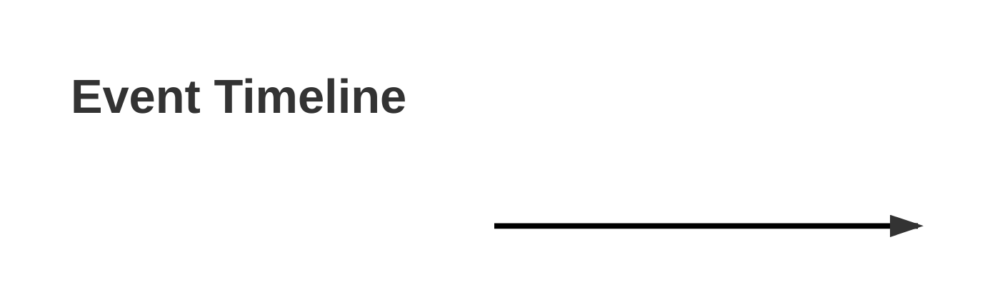
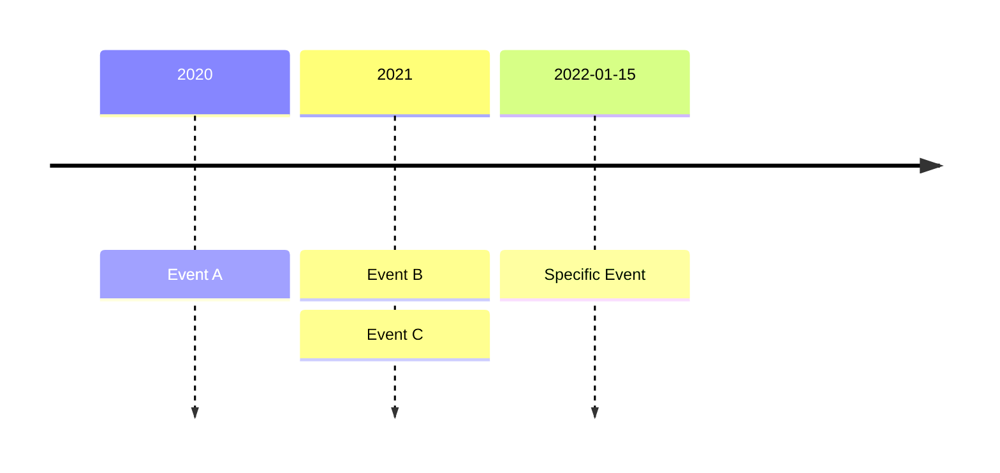
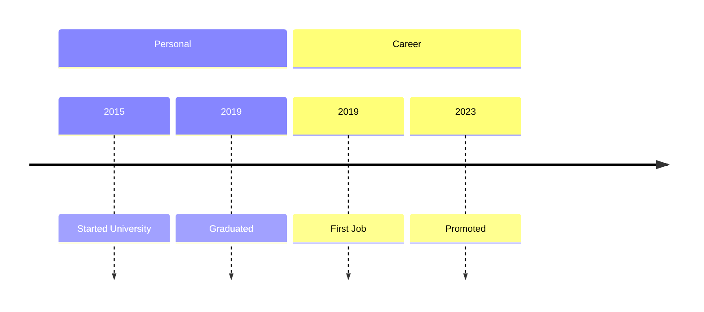

# Mermaid Timeline Syntax

Timelines in Mermaid visualize a series of events along a chronological axis, useful for historical events, project milestones, or personal achievements.

## Diagram Declaration

Starts with the `timeline` keyword.



## Events

Events are structured by a date/year, followed by one or more event descriptions for that period.

`YYYY : Event Description`
or
`YYYY-MM-DD : Event Description`

Multiple events for the same date/period can be listed under it.

Example:


## Sections

Events can be grouped into sections to organize the timeline.

`section Section Title`

Example:


## Example Timeline

```mermaid
timeline
    title My Project Development Journey

    section Phase 1: Conception & Planning
    2023-01-01 : Project Idea Formed
    2023-01-15 : Requirements Gathering Started
    2023-02-10 : Initial Design Approved

    section Phase 2: Development & Testing
    2023-03-01 : Frontend Development Begins
    2023-03-15 : Backend API Development Begins
    2023-04-20 : Unit Tests Completed
    2023-05-01 : Integration Testing Starts

    section Phase 3: Deployment & Maintenance
    2023-06-01 : Beta Launch
    2023-07-01 : Public Release
    2023-08-01 : First Minor Update
```
