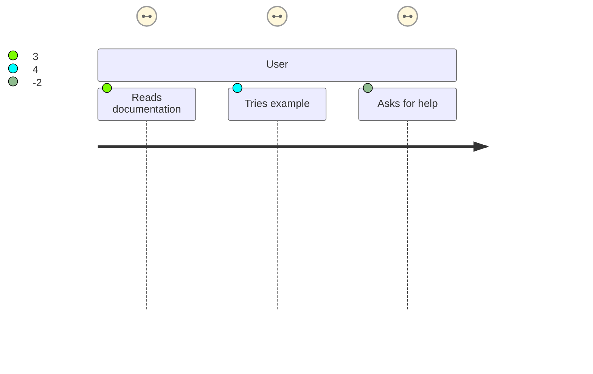
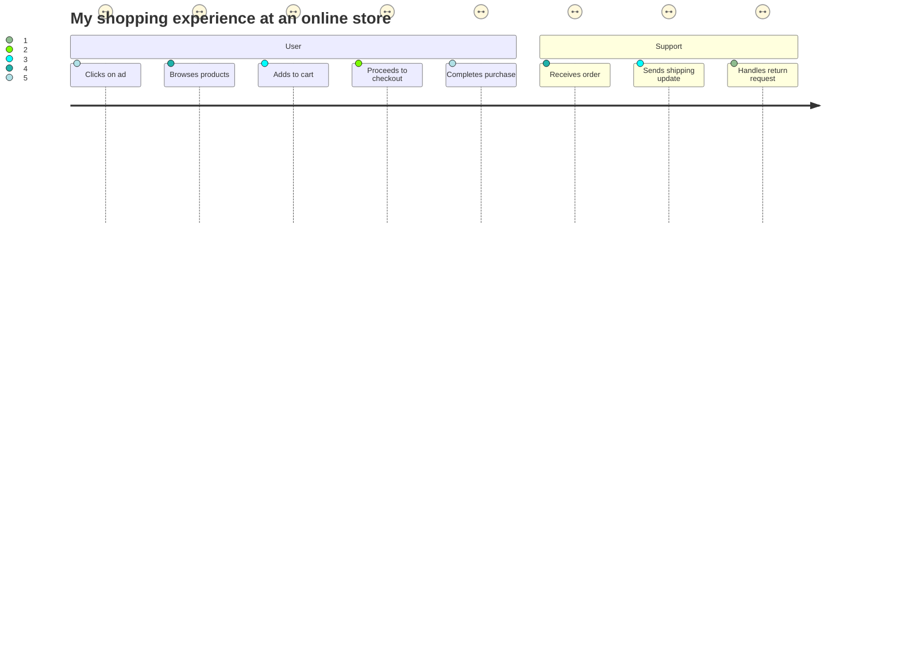

# Mermaid User Journey Syntax

User Journey Maps in Mermaid visualize the user's experience when interacting with a product or service, from their perspective. It outlines their goals, actions, thoughts, and feelings.

## Diagram Declaration

Starts with the `journey` keyword.


## Sections (Actors/Personas)

Each section typically represents a different persona or actor in the journey.

```mermaid
journey
    section Customer
    ...
    section Support
    ...
```

## Tasks/Stages

Tasks are the steps or stages within a section of the user journey.

`Task Name: Stage Name: Score`

-   **`Task Name`**: A description of the user's action or step.
-   **`Stage Name`**: The overarching stage of the journey (e.g., "Awareness", "Consideration", "Purchase").
-   **`Score`**: An optional numerical score reflecting the user's emotion/satisfaction at this stage (-5 to 5).

Example:


## Example User Journey Map


